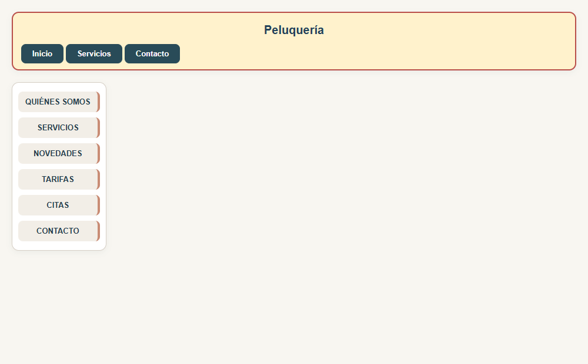

# UT3 – Tarea 4: Maquetación con Flexbox

## Qué debes hacer

Adapta la distribución de la cabecera y los menús de una página de la peluquería utilizando **Flexbox**. Dispones de [principal.html](principal.html) y [menus.css](menus.css). **Solo puedes trabajar en el CSS; el HTML debe mantenerse sin cambios.**

## Requisitos funcionales

- **RF01. Contenido.** Conserva el título «Peluquería» y todos los enlaces de los dos menús proporcionados.

## Requisitos no funcionales

- **RNF01. HTML original.** No puedes añadir, eliminar ni cambiar elementos, textos, clases o la estructura del HTML. Si modificas el HTML, la tarea se considerará incorrecta.
- **RNF02. Maquetación.** Utiliza Flexbox en la cabecera y en los menús. Toda la distribución debe resolverse con Flexbox, sin flotados, márgenes exagerados ni trucos similares.
- **RNF03. Restricción de posicionamiento.** No utilices `position` en ninguna de sus variantes: `absolute`, `relative`, `fixed`, `sticky` o `static`.
- **RNF04. Cabecera.** Debe tener exactamente **100px de alto**, borde **rojo, sólido, de 2px**, texto **azul** y fondo **amarillo**. El título debe estar centrado horizontal y verticalmente en su zona, por encima de la barra de enlaces.
- **RNF05. Barra superior.** Los enlaces de `.barra1` deben aparecer en **una sola fila**, con el conjunto alineado al **lado izquierdo** de la cabecera y en **orden inverso al del HTML**.
- **RNF06. Menú lateral.** Los enlaces de `<aside>` deben aparecer en **columna**, en **orden inverso al del HTML**. El menú debe ajustarse al ancho natural de su contenido.

### Referencia visual

La referencia utiliza tonos suaves de rojo, azul y amarillo, y menús con esquinas redondeadas. Los requisitos de distribución son los mismos.

## Qué debes entregar

1. **principal.html**, sin modificar y manteniendo su nombre.
2. **menus.css**, con los estilos del ejercicio y manteniendo su nombre.

## Rúbrica de evaluación

| Calificación | Criterio |
|---|---|
| 0 | **No entregado.** |
| 3 | **La mayoría de las respuestas son incorrectas.** La tarea presenta errores importantes que muestran una comprensión insuficiente de los contenidos o dificultades para aplicar los procedimientos trabajados. |
| 6 | **La mayoría de las respuestas son correctas.** Se demuestra una comprensión general de los contenidos y una aplicación adecuada de los procedimientos, aunque quedan errores u omisiones por corregir. |
| 9 | **Todo correcto.** La tarea responde de forma completa y correcta a lo solicitado, con explicaciones claras y procedimientos bien aplicados. |
| 10 | **Todo correcto y con una aportación extra.** Además de resolver correctamente la tarea, el alumno incorpora una aportación propia y pertinente que enriquece el trabajo y solicita su 10. |
